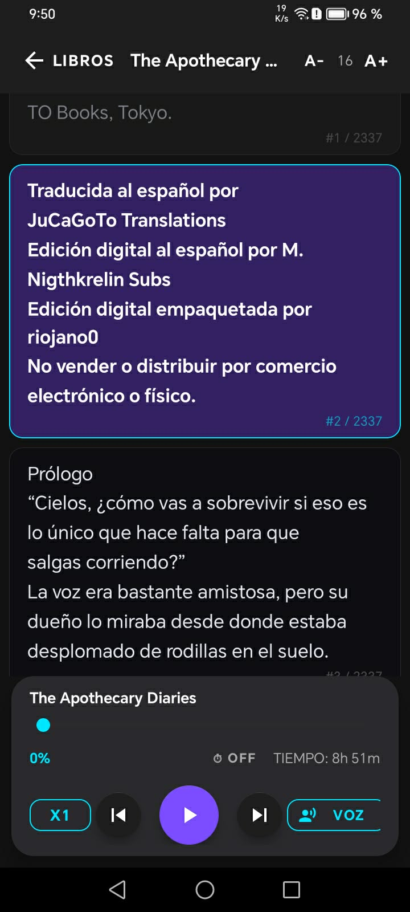
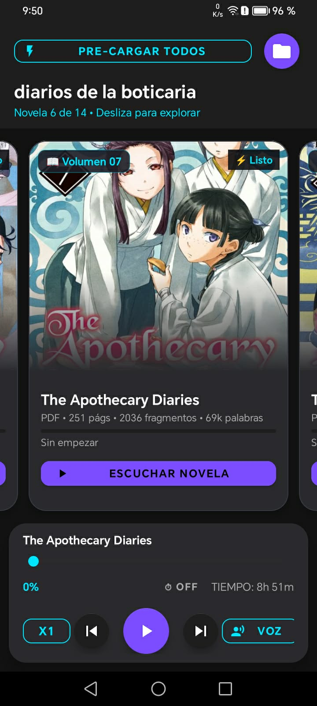
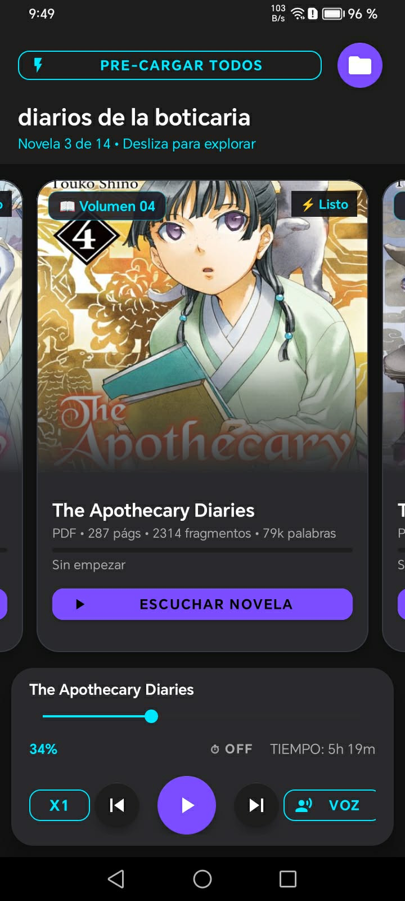

# 📚 Novela Audio Reader

-3DDC84?style=for-the-badge&logo=android&logoColor=white)

**Lector auditivo y visual de novelas ligeras, libros y literatura en formatos PDF, EPUB y TXT con síntesis de voz (TTS) ininterrumpida en segundo plano y pantalla apagada.**

[Descargar APK](#-descarga-e-instalación) • [Características](#-características-principales) • [Capturas de Pantalla](#-capturas-de-pantalla) • [Novedades](#-últimas-mejoras) • [Arquitectura](#-arquitectura-técnica)

---

## 🌟 ¿Qué es Novela Audio Reader?

**Novela Audio Reader** es un reproductor y lector offline diseñado especialmente para lectores de novelas ligeras, webnovels y libros extensos. 

A diferencia de los lectores convencionales que pausan la voz al bloquear el teléfono o que saturan la experiencia con publicidad, Novela Audio Reader funciona como un reproductor multimedia dedicado: puedes guardar el dispositivo en el bolsillo o apagar la pantalla y disfrutar de una narración continua, fluida y sin silencios entre párrafos.

---

## ✨ Características Principales

### 🎧 Lectura Auditiva Continua (Pantalla Apagada y Segundo Plano)
- **Foreground Service con WakeLock parcial:** Diseñado para sesiones de lectura prolongadas sin que el optimizador de batería o el sistema cierren el proceso.
- **Pre-encolado Inteligente de Fragmentos (Zero-Silence):** El siguiente párrafo se sintetiza en memoria antes de que termine el actual, eliminando baches o pausas molestas entre oraciones.
- **Controles Multimedia Nativos (`MediaSessionCompat`):** Controla Play/Pausa, fragmento anterior o siguiente desde la pantalla de bloqueo, la barra de notificaciones o mediante botones en auriculares Bluetooth.
- **Notificación 100% Silenciosa:** Canal de notificación optimizado de baja prioridad (`IMPORTANCE_LOW`) que actualiza el progreso en vivo sin emitir sonidos, vibraciones ni alertas intrusivas con cada cambio de párrafo.

### 📖 Soporte Multiformato Seguro y Nativo
- **PDF:** Extracción ligera y renderizado por páginas sin saturar la memoria RAM.
- **EPUB:** Extractor nativo por streaming con `ZipFile` y parsing XML. Limpieza automática de artefactos XHTML y depuración de caracteres comodín `[OBJ]` de ilustraciones para que no entorpezcan el TTS.
- **TXT:** Detección automática UTF-8 con fallback transparente a ISO-8859-1 / Windows-1252 para conservar tildes, signos de apertura y la letra `ñ`.
- **Segmentación Literaria:** Fragmentación en bloques óptimos de ~300 caracteres respetando oraciones completas y rayas de diálogo en español (`—` y `–`).

### 🖼️ Riel de Biblioteca con Portadas en Alta Definición
- **Cabecera Funcional de 2 Filas:** Botón directo *"Pre-cargar Todos"* para procesar y cachear en lote toda una carpeta de novelas, y selector rápido de carpeta raíz.
- **Ordenamiento Inteligente:** Clasificación alfabética por título limpio y orden ascendente por volumen (`Volumen 01`, `Volumen 02`, `Volumen 1.5`...).
- **Portadas con Subsampling Seguro:** Detección de portadas en EPUB y PDF decodificadas en dos pasos (*2-pass inSampleSize*) hacia ~540px, garantizando miniaturas nítidas sin sobrecargar la GPU ni disparar OutOfMemory.

### 👁️ Modo Baja Visión y Accesibilidad
- **Tipografía Escalable Ampliada:** Rango de tamaño de fuente desde 12sp hasta **44sp** con ajuste fino de `±2sp`.
- **Resaltado de Alto Contraste:** El párrafo que se está narrando se ilumina con acento cian brillante sobre fondo oscuro, mientras los párrafos leídos mantienen un contraste suave y descansado.
- **Anti-Toques Accidentales:** El salto manual de lectura y audio requiere un **doble toque** deliberado con respuesta háptica sutil, permitiendo hacer scroll libremente sin saltar de fragmento por error.
- **Botón Flotante "Volver a la voz":** Si te desplazas manualmente por el texto, aparece un botón flotante que te devuelve en un solo toque al párrafo exacto que está sonando.

### ⏱️ Temporizador de Apagado (Sleep Timer)
- Programa el apagado automático a los **15, 30, 45 o 60 minutos**, o tras leer **X fragmentos**.
- Pausa suave del audio con visualización del tiempo restante formateado de manera legible (`TIEMPO: 5h 20m` o `TIEMPO: 14:32`).

### 📱 Diseño Ergonómico y Bloqueo Vertical
- Orientación fijada en modo vertical (*portrait*) para una lectura cómoda y natural con una sola mano.

### 🚫 Privacidad y Cero Publicidad
- **Sin anuncios, sin compras integradas, sin telemetría y sin requerir conexión a internet.**
- Todos tus libros, portadas y cachés permanecen únicamente en tu almacenamiento local.

---

## 📸 Capturas de Pantalla

| Riel de Biblioteca | Modo Lectura & Baja Visión | Reproductor Persistente |
| :---: | :---: | :---: |
|  |  |  |

---

## 🆕 Últimas Mejoras Incorporadas

- **Soporte completo EPUB y TXT:** Incorporación de motores nativos de descompresión y lectura de texto plano sin dependencias externas pesadas.
- **Silencio total en notificaciones de lectura:** Erradicación definitiva de pitidos o vibraciones entre fragmentos con canal de baja prioridad.
- **Rango tipográfico hasta 44sp:** Mejor legibilidad para usuarios con debilidad visual o pantallas grandes.
- **Bloqueo vertical de pantalla:** Prevención de giros accidentales al cambiar de postura mientras se lee o escucha.
- **Cabecera de biblioteca en dos filas:** Mayor legibilidad en títulos largos y acceso inmediato a pre-carga masiva.
- **Nuevo icono oficial:** Libro estilizado con auriculares over-ear y ondas sonoras TTS, compatible con iconos adaptativos modernos.
- **Firma permanente de producción:** Compilaciones release firmadas oficialmente para una instalación limpia y directa.

---

## 📥 Descarga e Instalación

Puedes descargar el instalador directamente desde este repositorio:

- 📦 **Descarga directa:** [**`NovelaAudioReader.apk`**](./NovelaAudioReader.apk?raw=true) *(13.3 MB, versión Release compilada y optimizada)*
- 🚀 **O desde la sección de [Releases](../../releases):** Donde encontrarás notas de versión y enlaces de descarga.

### Pasos de instalación:
1. Descarga el archivo **`NovelaAudioReader.apk`** en tu dispositivo Android.
2. Abre el archivo y concédele permiso para instalar fuentes desconocidas si el sistema lo solicita.
3. Inicia **Novela Audio Reader**, pulsa en *"Detectar Carpeta de Novelas"* y selecciona el directorio donde guardas tus archivos PDF, EPUB o TXT.
4. Elige tu novela favorita en el riel de portadas y ¡comienza tu lectura!

---

## 🛠️ Tecnologías y Arquitectura

- **Lenguaje:** Java 17 puro para Android (soporta desde Android 7.0 / API 24 hasta Android 15 / API 35).
- **Motor de Audio:** `android.speech.tts.TextToSpeech` integrado con `MediaSessionCompat` y `ForegroundService`.
- **Procesamiento de Archivos:** `PdfRenderer`, `java.util.zip.ZipFile`, `XmlPullParser`, streaming con `android.util.JsonReader`.
- **UI:** Material Components Android, `RecyclerView` horizontal con `PagerSnapHelper`, arquitectura Anti-Descuadre y Zero-GC en tareas de fondo.

---

## 📄 Licencia

Este proyecto está bajo la Licencia **MIT**. Consulta el archivo `LICENSE` para más información.
